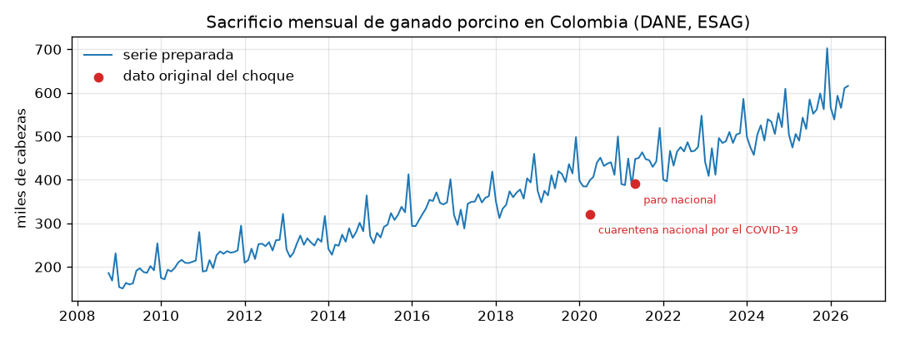
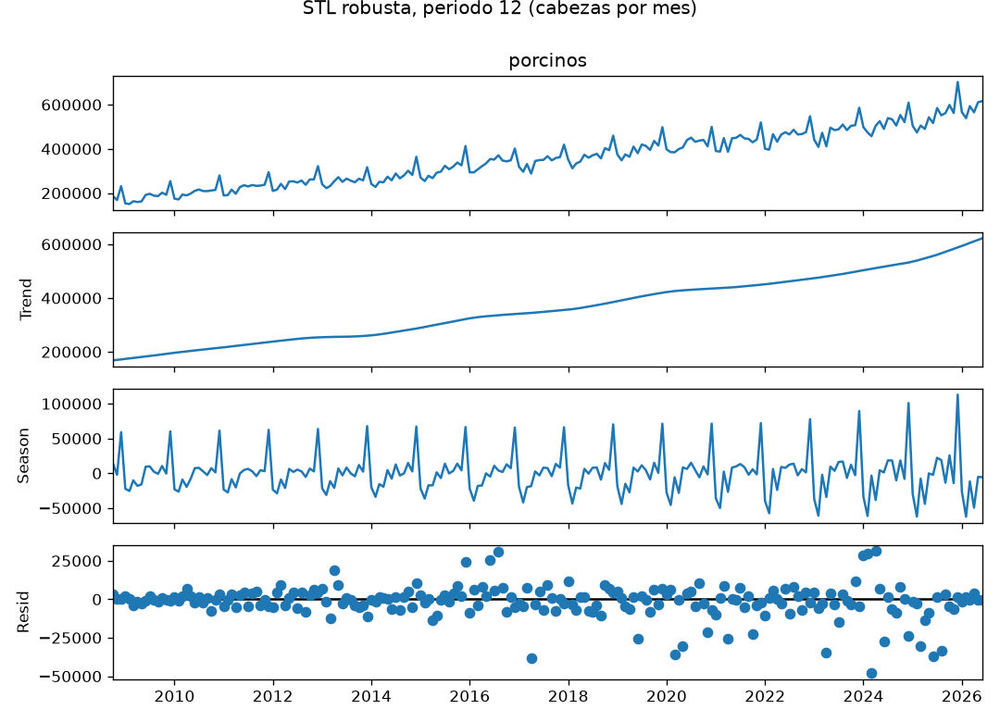
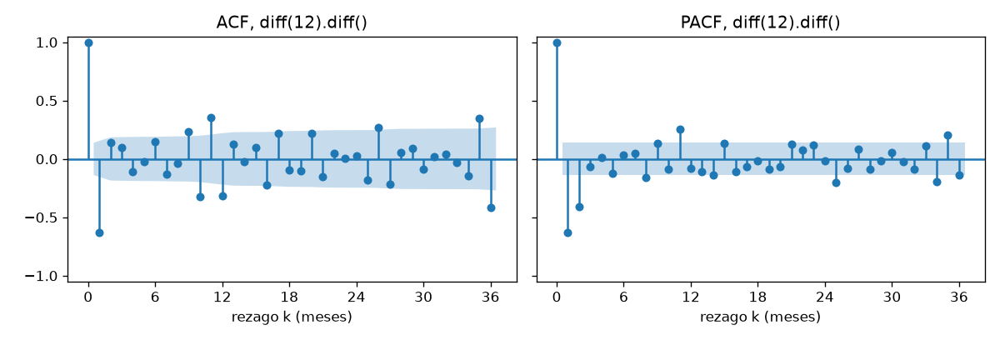
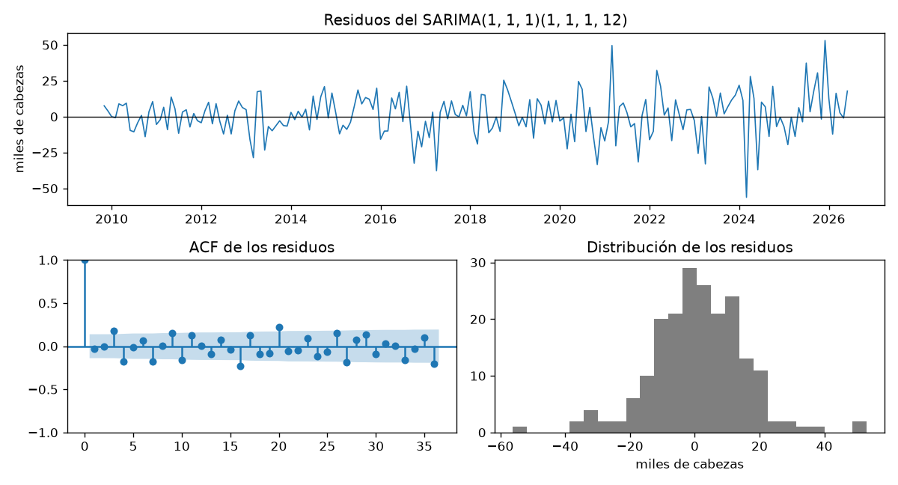
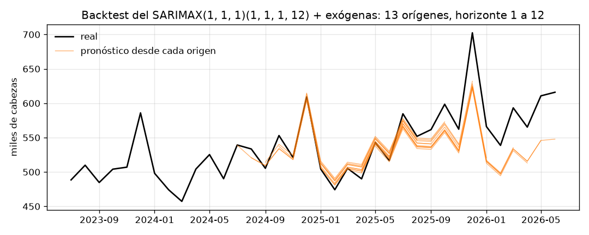

# Informe del miniproyecto 1

Las cifras salen de lo que imprime `python miniproyecto.py` y las figuras
son las que ese guion deja en `figuras/`.

## 1. La serie

La serie es el número de **cabezas de ganado porcino sacrificadas por mes
en Colombia**, total nacional. La publica el DANE en la Encuesta de
Sacrificio de Ganado (ESAG), en el cuadro 3 de sus series históricas. Es
información pública y se puede usar citando la fuente. Es mensual y va de
**octubre de 2008 a junio de 2026**: son **213 observaciones**, y los meses
de 2026 son preliminares. La ficha completa está en `datos/README.md`.

Esta serie cumple de sobra los mínimos y es interesante de modelar.
Tiene una tendencia fuerte, porque el sector porcícola colombiano casi se
cuadruplicó en el periodo. Tiene una estacionalidad muy marcada, con el pico
de diciembre por la demanda de fin de año. Y tiene choques identificables:
la pandemia, el paro nacional y la Semana Santa. Es la misma serie de los
talleres 1 y 2.

**Huecos.** La serie no tiene meses vacíos (`0 vacíos`). Aun así,
`preparar` interpola linealmente por si una actualización del DANE dejara
alguno.

**Datos atípicos.** Una STL robusta sobre la serie original señala estos
meses como los más atípicos, todos con peso robusto 0:

| Mes | Observado | Esperado (tendencia + estacional) | Residuo | Residuo / desv. |
|---|---|---|---|---|
| 2020-04 | 321 055 | 399 077 | −78 022 | −6,23 |
| 2021-05 | 390 325 | 447 915 | −57 590 | −4,60 |
| 2024-03 | 457 278 | 505 097 | −47 819 | −3,82 |
| 2017-04 | 288 116 | 325 986 | −37 870 | −3,02 |
| 2025-06 | 516 776 | 553 930 | −37 154 | −2,97 |

Cada uno recibió una decisión distinta:

- **Abril de 2020** (cuarentena nacional por el COVID-19) y **mayo de 2021**
  (paro nacional, con bloqueos de vías) son choques de un solo mes, de causa
  externa conocida, que no se van a repetir con el calendario. **Se
  reemplazan** por el valor que la STL robusta esperaba en ese mes, tendencia
  más estacional: 321 055 → 399 077 y 390 325 → 447 915. Con
  `robust=True`, ese valor esperado no se deja arrastrar por el propio
  choque. Los dos meses quedan antes del primer origen del *backtest*
  (2024-06), así que la corrección no toca ningún mes de prueba ni usa datos
  posteriores a un origen.
- **Marzo de 2024, abril de 2017 y junio de 2025** **se dejan**. No son
  choques aislados, sino efectos de calendario. En 2024 la Semana Santa cayó
  en marzo; marzo y abril cambian de un año a otro según dónde cae, y junio
  acumula varios festivos que se trasladan al lunes. Ese efecto se repite y
  se puede conocer de antemano, así que debe modelarlo la exógena de días
  hábiles (sección 5) y no borrarse de los datos.

Esta es la columna `decision` de la tabla: *sin huecos; abr-2020 y may-2021
(cuarentena y paro) reemplazados por tendencia + estacional de la STL
robusta*.

**El experimento: ¿la corrección ayuda?** El guion pasa el mismo SARIMA
elegido por el *backtest* sobre la serie sin corregir. Los meses de prueba
son idénticos en las dos versiones, así que las métricas se pueden comparar.
Sin corregir, el SARIMA da RMSE 27 759,47, MAE 23 043,24 y MAPE 4,02 %.
Corregido da RMSE 28 642,85, MAE 23 854,23 y MAPE 4,16 %. **La corrección no
mejora el pronóstico; lo empeora un 3,2 % en RMSE.** Una lectura posible es
esta: con los dos choques en los datos, el modelo estima coeficientes MA que
descuentan más las sorpresas, y esa cautela le sirve en 2024-2026, que
también tiene meses atípicos (2024-03, 2025-06). Mantenemos la corrección
por dos razones. Primera, con ella la identificación queda limpia: en la
serie corregida, la ADF de `diff()` ya no rechaza (sección 4), mientras que
en la original los dos desplomes hacían que `diff()` pareciera estacionaria
(valor p 0,009 en el taller 1). Segunda, el modelo de la sección 5 no queda
contaminado por dos meses que no van a volver. La diferencia de 3,2 % es
pequeña frente a la distancia con las líneas base (sección 6).

## 2. Componentes

La STL robusta con periodo 12 separa tres componentes:

- **Tendencia.** Crece sin interrupción: va de 168 278 cabezas/mes en
  2008-10 a 621 940 en 2026-06. Es un factor de **×3,70**, cerca de
  **7,7 % anual**. Se aplana entre 2020 y 2021 y vuelve a acelerar desde
  2024.
- **Estacional.** Este es el promedio por mes del año:

  | ene | feb | mar | abr | may | jun | jul | ago | sep | oct | nov | dic |
  |---|---|---|---|---|---|---|---|---|---|---|---|
  | −25 691 | −43 201 | −9 771 | −25 878 | +2 571 | +1 190 | +11 811 | +6 601 | −4 397 | +12 104 | +452 | **+72 587** |

  **Diciembre** es el mes alto, con +72 587 cabezas: es la demanda de carne
  de cerdo de fin de año. **Febrero** es el más bajo, con −43 201: es un mes
  corto y viene después de la temporada. Le siguen abril (−25 878, Semana
  Santa) y enero (−25 691). La amplitud crece con el nivel: la estacional
  de diciembre pasa de 59 182 en 2008 a 112 988 en 2025. Esa es la firma de
  una estacionalidad multiplicativa, que un modelo aditivo como el SARIMA
  sobre la serie en niveles no captura del todo (sección 7).
- **Residuo.** Con los dos choques ya corregidos, los residuos más grandes
  son **2024-03 (−47 901)**, por la Semana Santa en marzo, 2017-04
  (−38 018) y 2025-06 (−37 251). Todos son negativos y todos tienen que ver
  con el calendario.

## 3. Líneas base y backtest

El *backtest* es el de `comun.py`, con origen móvil sobre los últimos 24
meses y horizonte de 1 a 12. Con $N = 213$, los cortes van de
$N - 24 = 189$ a $N - 12 = 201$: son **13 orígenes, de 2024-06 a 2025-06**.
Los meses que se pronostican van de **2024-07 a 2026-06**. No son 24
orígenes, sino $24 - 12 + 1 = 13$, porque cada origen necesita los 12 meses
reales siguientes para medir todos los horizontes. Las métricas de cada
origen se promedian:

$$\text{RMSE} = \sqrt{\frac{1}{h}\sum_{i=1}^{h}(y_{t+i}-\hat y_{t+i})^2},\qquad
\text{MAE} = \frac{1}{h}\sum_{i=1}^{h}\lvert y_{t+i}-\hat y_{t+i}\rvert,\qquad
\text{MAPE} = \frac{100}{h}\sum_{i=1}^{h}\left\lvert\frac{y_{t+i}-\hat y_{t+i}}{y_{t+i}}\right\rvert$$

**Por qué no hay fuga.** En cada origen, `backtest` le pasa al modelo
`serie.iloc[:corte]`, solo los meses hasta el origen. El modelo se vuelve a
ajustar desde cero con esos datos y devuelve $h$ pronósticos. Los valores
reales `serie.iloc[corte:corte + h]` solo se usan para calcular el error,
después de pronosticar. La exógena del SARIMAX es calendario: para los meses
futuros se toma de `x.loc[fechas_siguientes(entrenamiento, h)]`, que se
conoce desde antes del origen (sección 5). La corrección de los choques de
la sección 1 cae en 2020 y 2021, antes del primer origen.

Las líneas base son el **ingenuo**, $\hat y_{t+i} = y_t$, y el **estacional
ingenuo**, $\hat y_{t+i} = y_{t+i-12k}$, que repite el mismo mes del último
año observado:

| Modelo | RMSE | MAE | MAPE (%) |
|---|---|---|---|
| ingenuo | 64 594,38 | 53 658,85 | 9,40 |
| estacional ingenuo | 43 141,26 | 37 837,01 | 6,64 |

**El estacional ingenuo gana en las tres métricas**: un 33,2 % menos de RMSE y
un 29,5 % menos de MAE. Es lo esperado con una estacional de ±70 000 cabezas.
El ingenuo repite, por ejemplo, el pico de diciembre durante todo el año
siguiente, o el valle de febrero durante diciembre. El estacional ingenuo
acierta la forma del año, pero se queda en el nivel del año anterior y no
ve la tendencia del 7,7 % anual. Por eso, con el *backtest*, su error es
sobre todo de subestimación.

## 4. Estacionariedad e identificación

La prueba ADF tiene como hipótesis nula $H_0$ que la serie tiene raíz
unitaria. Con un valor p menor que 0,05 se rechaza. La serie original se
prueba con `regression="ct"` (constante y tendencia), porque crece sobre una
recta: con `"c"`, esa tendencia determinista se confundiría con una raíz
unitaria. Las versiones diferenciadas ya no tienen tendencia y se prueban
con `"c"`. El guion agrega la ACF en el rezago 12, porque la ADF no evalúa
la raíz estacional:

| Versión | d | D | regression | Estadístico | Valor p | ACF(12) |
|---|---|---|---|---|---|---|
| original | 0 | 0 | ct | −0,912 | 0,9549 | 0,80 |
| `diff()` | 1 | 0 | c | −2,521 | 0,1104 | 0,77 |
| `diff(12)` | 0 | 1 | c | −2,543 | 0,1054 | −0,20 |
| `diff(12).diff()` | 1 | 1 | c | −4,138 | **0,0008** | −0,31 |

**Elegimos d = 1 y D = 1.** La regla es tomar la versión con menos
diferencias que cumpla dos condiciones: que la ADF rechace la raíz unitaria
($p<0{,}05$) y que la ACF en el rezago 12 no quede persistente
($r_{12}<0{,}5$). Ni `diff()` ni `diff(12)` rechazan ($p = 0{,}11$ en las
dos). Además, `diff()` conserva $r_{12} = 0{,}77$: el patrón anual sigue
intacto después de la diferencia regular. Solo `diff(12).diff()` cumple las
dos condiciones, con $p = 0{,}0008$. La serie que se modela es

$$w_t = (1-B)(1-B^{12})\,y_t = (y_t - y_{t-1}) - (y_{t-12} - y_{t-13}).$$

Con 200 datos, la banda es aproximadamente $\pm 1{,}96/\sqrt{200} = \pm 0{,}139$.
El guion la calcula rezago por rezago, y se ensancha con $k$ en la ACF.
Estos son los rezagos que salen de la banda:

- **ACF:** 1 (−0,63), 9 (0,24), 10 (−0,32), 11 (0,36), **12 (−0,31)**,
  26 (0,27), 35 (0,35) y 36 (−0,41).
- **PACF:** 1 (−0,63), 2 (−0,41), 8 (−0,16), 11 (0,25), 25 (−0,20),
  34 (−0,19) y 35 (0,21).

**Qué sugieren.** En la parte regular, la ACF tiene una sola barra grande en
el rezago 1 (−0,63) y la PACF decae en los rezagos 1 y 2 (−0,63 y −0,41).
Es la firma de un **MA(1)**, $q = 1$; la PACF en 2 deja abierta la opción de
agregar un AR(1). En la parte estacional, la barra negativa en 12 (−0,31) y
en 36 (−0,41), después de aplicar `diff(12)`, indica que la diferencia
estacional dejó una dependencia negativa con el mismo mes del año anterior.
Eso apunta a un **MA estacional**, $Q = 1$. Las barras en 11 y 13 (o 35)
alrededor de 12 son la interacción entre el MA regular y el estacional.
Con esto, la rejilla con $p, q, P, Q \in \{0, 1\}$ cubre los candidatos.

## 5. Modelos clásicos

**La rejilla.** d y D quedan fijos en 1. No compiten por AIC porque cambian
la serie que se modela, y los AIC de series distintas no se comparan. La
rejilla prueba $p, q, P, Q \in \{0,1\}$, 16 modelos ajustados sobre
`serie / 1000` (miles de cabezas) con
$\text{AIC} = 2k - 2\ln\hat L$:

| # | order | seasonal_order | AIC |
|---|---|---|---|
| 0 | (1, 1, 1) | (1, 1, 1, 12) | **1660,7** |
| 1 | (1, 1, 1) | (0, 1, 1, 12) | 1665,0 |
| 2 | (0, 1, 1) | (1, 1, 1, 12) | 1672,1 |
| 3 | (0, 1, 1) | (0, 1, 1, 12) | 1674,6 |
| 4 | (1, 1, 0) | (1, 1, 1, 12) | 1693,3 |
| 5 | (1, 1, 1) | (1, 1, 0, 12) | 1698,4 |
| 6 | (1, 1, 0) | (0, 1, 1, 12) | 1699,9 |
| 7 | (0, 1, 1) | (1, 1, 0, 12) | 1709,6 |
| 8 | (1, 1, 1) | (0, 1, 0, 12) | 1711,6 |
| 9 | (0, 1, 1) | (0, 1, 0, 12) | 1726,4 |
| 10 | (1, 1, 0) | (1, 1, 0, 12) | 1734,3 |
| 11 | (1, 1, 0) | (0, 1, 0, 12) | 1743,5 |
| 12 | (0, 1, 0) | (1, 1, 1, 12) | 1784,2 |
| 13 | (0, 1, 0) | (0, 1, 1, 12) | 1786,3 |
| 14 | (0, 1, 0) | (1, 1, 0, 12) | 1822,6 |
| 15 | (0, 1, 0) | (0, 1, 0, 12) | 1841,8 |

Los cuatro primeros tienen $q = 1$ y $Q = 1$, lo que confirma la lectura de
la ACF. Quitar el MA estacional (fila 5) cuesta 38 puntos y quitar el MA
regular (fila 4), 33. El AR(1) que sugería la PACF en el rezago 2 baja el
AIC 11,4 puntos (fila 2 frente a fila 0).

**El modelo elegido** es el **SARIMA(1,1,1)(1,1,1)₁₂**, con AIC 1660,7.
Con la convención de `statsmodels`,

$$(1-\phi_1 B)(1-\Phi_1 B^{12})(1-B)(1-B^{12})\,y_t = (1+\theta_1 B)(1+\Theta_1 B^{12})\,\varepsilon_t,\qquad \varepsilon_t\sim \mathcal N(0,\sigma^2)$$

y con los coeficientes estimados:

$$(1+0{,}350B)(1-0{,}222B^{12})\,w_t = (1-0{,}539B)(1-0{,}852B^{12})\,\varepsilon_t,\qquad \hat\sigma^2 = 211{,}97\ (\text{miles}^2)$$

| Coeficiente | Valor | Valor p | Lectura |
|---|---|---|---|
| $\phi_1$ (`ar.L1`) | −0,350 | 0,000 | un mes alto en $w_t$ tiende a seguirse de uno bajo |
| $\theta_1$ (`ma.L1`) | −0,539 | 0,000 | se descuenta el 54 % de la sorpresa del mes anterior |
| $\Phi_1$ (`ar.S.L12`) | 0,222 | 0,036 | el mismo mes del año anterior se repite en un 22 % |
| $\Theta_1$ (`ma.S.L12`) | −0,852 | 0,000 | se descuenta el 85 % de la sorpresa del mismo mes del año anterior |

Todos los coeficientes son significativos al 5 %. La desviación de la
sorpresa mensual es $\hat\sigma = \sqrt{211{,}97} \approx 14{,}6$ miles de
cabezas.

**Diagnóstico de los residuos.** Ljung-Box pone a prueba $H_0$: los
residuos son ruido blanco. Se aplica sin los primeros $d + 12D = 13$ meses,
que absorben el arranque de las diferencias:

$$Q = n(n+2)\sum_{k=1}^{m}\frac{r_k^2}{n-k}$$

| Rezagos $m$ | $Q$ | Valor p |
|---|---|---|
| 12 | 34,08 | 0,0007 |
| 24 | 73,20 | 0,0000 |

**Se rechaza el ruido blanco en los dos rezagos: queda estructura.** La
ACF de los residuos lo muestra en barras que rozan o pasan la banda en los
rezagos 3, 4, 7, 16, 20 y 36. Ninguna es grande por sí sola, pero juntas
pesan. La gráfica de los residuos en el tiempo muestra además que la
varianza crece desde 2020, con el nivel de la serie. Los residuos más
grandes son **2024-03 (−56 180)**, **2025-12 (+53 093)** y 2021-03
(+49 598). El de marzo de 2024 es la Semana Santa en marzo, un efecto del
calendario que el SARIMA no ve. El de diciembre de 2025 es el pico de fin
de año más alto de la serie, que crece más rápido que lo que el modelo
aditivo permite. El histograma es aproximadamente simétrico, con colas
largas en esos meses. En conclusión, el SARIMA sirve para pronosticar, pero
sus intervalos serían optimistas y deja información del calendario sin
usar. Eso motiva la exógena.

**La variable exógena.** El SARIMAX agrega una regresión sobre $x_t$ con
errores SARIMA:

$$y_t = \beta\,x_t + \eta_t,\qquad \eta_t \sim \text{SARIMA}(1,1,1)(1,1,1)_{12}$$

Probamos dos variables del calendario colombiano, del paquete `holidays`.
Cada una se ajustó sobre toda la serie, con el mismo SARIMA:

| Exógena | AIC | $\hat\beta$ (cabezas) | Valor p de $\beta$ | Ljung-Box p (12) | Ljung-Box p (24) |
|---|---|---|---|---|---|
| festivos del mes | 1630,6 | −10 633 por festivo | 0,0000 | 0,0000 | 0,0000 |
| **días hábiles** (lunes a viernes no festivos) | **1551,1** | **+8 106 por día hábil** | 0,0000 | **0,5709** | **0,1680** |

Elegimos los **días hábiles**. Las plantas de beneficio sacrifican en días
laborales: cada día hábil adicional suma unas **8 106 cabezas** al mes, con
todo lo demás igual. La variable junta los festivos con la cantidad de
fines de semana del mes, que varía entre 8 y 10, y ese segundo efecto es el
que el conteo de festivos no ve. Con ella, el AIC baja 109,6 puntos frente
al SARIMA (de 1660,7 a 1551,1), contra 30 puntos con los festivos. Además,
**Ljung-Box ya no rechaza** (p = 0,57 en 12 y 0,17 en 24): la estructura que
dejaba el SARIMA era, sobre todo, efecto del calendario.

**Por qué se conoce de antemano y no hay fuga.** Los festivos de Colombia
los fija la ley (la Ley Emiliani traslada la mayoría al lunes), y los fines
de semana son aritmética del calendario. Los días hábiles de cualquier mes
futuro se saben con años de anticipación. Los de los 12 meses que siguen a
la serie son 21, 19, 22, 21, 19, 21, 19, 20, 20, 22, 19 y 21. En el
*backtest*, el modelo se ajusta con `x.loc[entrenamiento.index]` y
pronostica con `x.loc[fechas_siguientes(entrenamiento, h)]`. Eso no usa
nada que no se supiera en el origen. Si la exógena solo se conociera
después de cada mes, como el precio del cerdo o las importaciones, usar
su valor real en el pronóstico sería fuga. Las métricas saldrían
optimistas, y en la práctica habría que pronosticar también la exógena,
con su propio error.

**¿Mejora al SARIMA?** Sí, en las tres métricas del *backtest*: RMSE
25 279,41 frente a 28 642,85 (−11,7 %), MAE 20 848,26 frente a 23 854,23
(−12,6 %) y MAPE 3,60 % frente a 4,16 %.

## 6. Tabla de métricas

`resultados/metricas.csv`, ordenada por RMSE. Todas las filas tienen la
misma decisión: *sin huecos; abr-2020 y may-2021 (cuarentena y paro)
reemplazados por tendencia + estacional de la STL robusta*.

| Modelo | Decisión | RMSE | MAE | MAPE (%) |
|---|---|---|---|---|
| SARIMAX(1, 1, 1)(1, 1, 1, 12) + exógenas | sin huecos; abr-2020 y may-2021 (cuarentena y paro) reemplazados por tendencia + estacional de la STL robusta | 25 279,41 | 20 848,26 | 3,60 |
| SARIMA(1, 1, 1)(1, 1, 1, 12) | sin huecos; abr-2020 y may-2021 (cuarentena y paro) reemplazados por tendencia + estacional de la STL robusta | 28 642,85 | 23 854,23 | 4,16 |
| estacional ingenuo | sin huecos; abr-2020 y may-2021 (cuarentena y paro) reemplazados por tendencia + estacional de la STL robusta | 43 141,26 | 37 837,01 | 6,64 |
| ingenuo | sin huecos; abr-2020 y may-2021 (cuarentena y paro) reemplazados por tendencia + estacional de la STL robusta | 64 594,38 | 53 658,85 | 9,40 |

## 7. Conclusión

El **mejor modelo clásico es el SARIMAX(1,1,1)(1,1,1)₁₂ con los días
hábiles del mes como exógena**. Frente a la mejor línea base, el estacional
ingenuo, mejora así:

| Métrica | SARIMAX | Estacional ingenuo | Mejora |
|---|---|---|---|
| RMSE | 25 279,41 | 43 141,26 | −41,4 % |
| MAE | 20 848,26 | 37 837,01 | −44,9 % |
| MAPE | 3,60 % | 6,64 % | −45,8 % |

En promedio se equivoca en unas 20 800 cabezas por mes, el 3,6 % del
sacrificio. Lo explica la suma de las tres piezas: la diferencia regular
sigue la tendencia que el estacional ingenuo no ve, los términos
estacionales mantienen la forma del año y los días hábiles explican la
variación del calendario de un año a otro.

**Dónde sigue fallando.** Los pronósticos de los 13 orígenes muestran tres
debilidades:

- **El error crece con el horizonte y siempre hacia abajo.** El MAE pasa de
  7 623 cabezas a 1 mes a 37 948 a 12 meses. El sesgo (real − pronóstico)
  pasa de +846 a +37 317. El modelo **subestima en el 65 % de los
  pronósticos**: la tendencia se aceleró en 2025-2026 y la diferencia
  regular la extrapola con la pendiente promedio del pasado. En la figura
  se ve que el primer semestre de 2026 (preliminar) queda muy por encima
  de todos los pronósticos.

- **Diciembre es el peor mes**, con MAE de 43 225 y sesgo de +41 466. Le
  siguen octubre (28 866) y enero (26 475):

  | | ene | feb | mar | abr | may | jun | jul | ago | sep | oct | nov | dic |
  |---|---|---|---|---|---|---|---|---|---|---|---|---|
  | MAE | 26 475 | 22 883 | 20 914 | 22 502 | 13 104 | 10 748 | 13 612 | 10 746 | 18 139 | 28 866 | 18 965 | **43 225** |
  | sesgo | 19 556 | 9 165 | 16 201 | 801 | 8 572 | 85 | 13 612 | 10 746 | 15 564 | 28 866 | 17 857 | **41 466** |

  El pico de diciembre crece con el nivel (la estacional de diciembre pasó
  de 59 182 a 112 988 cabezas), pero el SARIMA en niveles lo trata como un
  patrón aditivo de amplitud fija.

- **Experimento con la corrección de datos.** Corregir los choques de 2020
  y 2021 no mejoró el *backtest* (+3,2 % de RMSE en el SARIMA). Ese
  resultado se reporta tal cual.

Para el miniproyecto 2 quedan dos ideas, sugeridas por estas cifras: modelar
el logaritmo de la serie, para volver multiplicativa la estacionalidad, y
darle al modelo una tendencia que pueda acelerar. **El SARIMAX con días
hábiles, RMSE 25 279,41 y MAPE 3,60 %, es el modelo que el miniproyecto 2
debe superar.**
